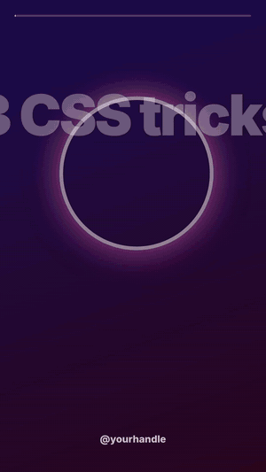
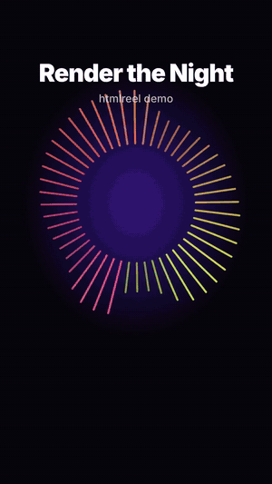

# htmlreel

**Write a web page. Get a video.** Render HTML & CSS into MP4s for **YouTube, Shorts, Instagram Reels and TikTok**.

[](https://github.com/umeshsaini8085/htmlreel/actions/workflows/ci.yml)
[](https://www.npmjs.com/package/htmlreel)
[](LICENSE)

<p align="center">
  
  &nbsp;
  
  <br>
  
</p>

<p align="center"><sub>All three are plain HTML files in <a href="examples/">examples/</a>, rendered by one command each.</sub></p>

```bash
npx htmlreel render reel.html --preset reel --audio song.mp3 --captions song.srt
```

`htmlreel` opens your page in headless Chrome, **seeks it frame by frame** instead of playing it in real time, and pipes every frame into FFmpeg. Anything a browser can draw becomes video: CSS animations, SVG, canvas, web fonts, gradients, `backdrop-filter`. The output is the same every time.

It was extracted from [SangeetFlow](#where-it-comes-from), a YouTube automation platform that renders music videos, lyric videos and narrated explainers with it every day.

---

## Features

- 🎬 **Any HTML → MP4.** H.264 + AAC with `faststart`, ready to upload anywhere.
- 🎯 **Deterministic.** Time is virtual: `Date.now()`, `performance.now()` and `Math.random()` are frozen per frame, so the same input gives identical pixels and nothing ever stutters.
- ⚡ **Fast.** Parallel workers (one browser each) and Chrome's BeginFrame API, which composites exactly one frame per call. Segments are joined without re-encoding.
- 📱 **Platform presets.** `youtube`, `shorts`, `reel`, `tiktok`, `story`, `square`, `instagram-portrait`, `youtube-4k`.
- 💬 **Word-by-word captions** from SRT / WebVTT, with a default style that stays clear of the Reels/TikTok UI. Restyle it with CSS.
- 🔊 **Audio-reactive.** The soundtrack's loudness arrives as the CSS variables `--level` and `--beat`, so visuals pulse with the music without any JS.
- 🎵 **Find the hook.** `findPeakWindow()` picks the most energetic N seconds of a song to cut into a Short or Reel.
- 🖼️ **Stills.** Thumbnails, cover images and poster frames from the same page.
- 🤖 **Safe for AI-generated HTML.** A `network: 'local'` sandbox, page-error reporting and blank-frame detection let you validate pages an LLM writes.
- 🧰 **CLI + typed Node API.** Bundled FFmpeg, no global installs.
- 🪶 **No framework.** It's just HTML. Handwritten, from a template engine, from React's `renderToString`, or written by an LLM.

## Where you can use it

| Use case | How htmlreel fits |
|---|---|
| **Instagram Reels, YouTube Shorts, TikTok** | 9:16 presets, captions placed above the app UI, music-synced motion. Batch-produce tips, quotes, listicles and promos from one template. |
| **YouTube videos** | Intros, outros, lower thirds, chapter cards, explainers, top-10 countdowns, and full narrated videos (TTS audio + captions + scenes). |
| **Lyric videos & music visualizers** | SRT lyrics with karaoke highlighting, audio-reactive canvas/SVG, automatic "best 30 seconds" cuts for Shorts. |
| **Faceless channels & content automation** | Generate videos from data on a schedule: news summaries, quotes of the day, stock/crypto/weather recaps, sports scores. |
| **AI video pipelines** | Have an LLM write the HTML scene, validate it with stills + blank-frame checks, render it. This is exactly what SangeetFlow does. |
| **Personalized videos at scale** | Sales outreach, onboarding, "your year in review", certificates: one template, thousands of `data` payloads. |
| **Product marketing** | Launch teasers, changelog videos, feature highlights and app-store previews, in your real brand CSS. |
| **Podcasts & audio** | Audiograms: waveform + captions + cover art for every episode clip. |
| **E-commerce** | Product promo reels from catalog data: photo, price, offer badge, call to action. |
| **Education** | Animated explainers, flashcards, code walkthroughs, slides with narration. |
| **Data storytelling** | Animated charts (D3, Chart.js with animation driven by `Reel.onFrame`) for social posts and reports. |
| **Thumbnails & covers** | `renderStill` gives you pixel-perfect PNGs for YouTube thumbnails, Reel covers and OG images. |

## Install

```bash
npm install htmlreel
npx htmlreel install-browser   # one-time download: the fast, deterministic headless Chrome
```

Node.js 20+. FFmpeg is bundled ([ffmpeg-static](https://github.com/eugeneware/ffmpeg-static)). If you skip `install-browser`, htmlreel falls back to any installed Chrome/Chromium using screenshot capture, which also works but is about 2× slower. Check what it found with `npx htmlreel doctor`.

## Quick start: CLI

```bash
# A 16:9 YouTube intro, 6 seconds
npx htmlreel render examples/youtube-intro/index.html --preset youtube --duration 6

# A 9:16 Reel with music and word-by-word captions (length taken from the audio)
npx htmlreel render examples/instagram-reel/index.html --preset reel \
  --audio examples/assets/beat.mp3 --captions examples/instagram-reel/captions.srt --duration 10

# A YouTube thumbnail
npx htmlreel still thumbnail.html --preset youtube -o thumbnail.png

# Work on it in your browser with a play/scrub bar (no rendering)
npx htmlreel preview reel.html --audio song.mp3
```

Run `npx htmlreel --help` for every option.

## Quick start: Node

```ts
import { renderVideo, parseSubtitles } from 'htmlreel';
import fs from 'node:fs';

const result = await renderVideo({
  file: 'reel.html',                       // or html: '<!doctype html>…'
  preset: 'reel',                          // 1080×1920 @ 30fps
  audio: { path: 'song.mp3', fadeOut: 1 },
  captions: parseSubtitles(fs.readFileSync('song.srt', 'utf8')),
  data: { title: 'Top 3 CSS tricks', handle: '@yourhandle' },  // → Reel.data in the page
  output: 'out/reel.mp4',
  onProgress: (p) => console.log(`${p.percent}% · ${p.fps} fps · eta ${p.etaSec}s`),
});
// → { output, frames: 300, durationSec: 10, width: 1080, height: 1920, engine: 'beginframe', renderSec: 31, pageErrors: [] }
```

## Writing a composition

A composition is a normal web page. htmlreel injects a small runtime (`window.Reel`) before your code runs and moves time forward for you. Animate with any of these:

**1. CSS animations.** They're paused and seeked to the exact frame time.

```css
.title { animation: pop .8s cubic-bezier(.2, 1.4, .3, 1) .5s both; }
```

**2. Scenes with `data-start` / `data-duration`.** The element is only visible in its window, and animations inside it start counting from `data-start`.

```html
<section data-start="0"   data-duration="2.5"> Hook </section>
<section data-start="2.5" data-duration="3">   Tip #1 (its animations start at 2.5 s) </section>
```

**3. CSS variables, updated every frame:**

| Variable | Meaning |
|---|---|
| `--t` | Current time in seconds |
| `--p` | Progress through the video, 0 → 1 |
| `--level` | Loudness of the soundtrack, 0 → 1 (smoothed) |
| `--beat` | A short pulse on each hit, 0 → 1 |

```css
.progress { transform: scaleX(var(--p)); }
.ring     { transform: scale(calc(1 + var(--level) * .2)); }
.bg       { background-position: calc(var(--t) * -40px) 0; }
```

**4. JavaScript per frame** for canvas, WebGL, D3, Three.js, anything:

```js
Reel.onFrame((t, Reel) => {
  ctx.clearRect(0, 0, W, H);
  drawBars(Reel.levelAt(t));
});
```

**5. Captions.** Pass `captions` (or `--captions file.srt`) and the runtime fills `#reel-captions` with `.reel-line > .reel-word` elements. Lines get `is-active` / `is-past` / `is-future` / `is-next`, words get `is-spoken` as they're said, and every line has `--lp` (line progress). Use the default style, or add your own `<div id="reel-captions">` and style it. See [examples/lyric-video](examples/lyric-video/index.html) for karaoke.

**The `Reel` object:** `Reel.t`, `Reel.duration`, `Reel.width`, `Reel.height`, `Reel.fps`, `Reel.data` (your JSON), `Reel.captions`, `Reel.levelAt(t)`, `Reel.beatAt(t)`, `Reel.activeCaption(t)`, `Reel.rand(seed)` (seeded PRNG), `Reel.onFrame(fn)`, `Reel.seek(t)`.

**Rules of thumb**

- Drive motion from time (CSS animations, `--t`, `onFrame`), never from `setTimeout`, `setInterval` or `requestAnimationFrame` loops.
- CSS `transition`s are disabled (they depend on wall-clock time). Use `@keyframes`.
- `<video>` elements aren't frame-synced yet. Use image sequences, CSS or canvas.
- Fonts and images are awaited before the first frame. Remote fonts (Google Fonts) work.
- Prefer `vmin` / `%` units, so one page renders correctly at every preset.

The full guide is in [docs/compositions.md](docs/compositions.md).

## Presets

| Preset | Size | For |
|---|---|---|
| `youtube` (default) | 1920 × 1080 | YouTube, Vimeo, LinkedIn, websites |
| `youtube-4k` | 3840 × 2160 | 4K uploads |
| `hd` | 1280 × 720 | Quick drafts |
| `shorts` / `reel` / `tiktok` / `story` | 1080 × 1920 | YouTube Shorts, Instagram Reels, TikTok, Stories, WhatsApp Status |
| `instagram-portrait` | 1080 × 1350 | Instagram feed (4:5) |
| `square` | 1080 × 1080 | Instagram / X / LinkedIn feed |

All are 30 fps. Override anything with `width`, `height`, `fps`. `scale: 2` renders at twice the pixel density for extra-sharp text.

## Rendering pages an LLM writes

htmlreel is a good target for generative video: models are very good at HTML and CSS. The pattern SangeetFlow uses in production:

```ts
import { renderStills, isBlankFrame, renderVideo } from 'htmlreel';

const html = await llm.generate(promptDescribingTheRuntimeContract);   // see docs/compositions.md

// 1. Validate cheaply: three stills, in a sandbox with no network access.
const frames = [1, duration / 2, duration - 1].map((time, i) => ({ time, output: `/tmp/check-${i}.png` }));
const { pageErrors } = await renderStills({ html, preset: 'youtube', duration, frames, network: 'local' });
const blank = await Promise.all(frames.map((f) => isBlankFrame(f.output)));

// 2. If it's broken, send the errors back to the model and ask for a fix (or fall back to a template).
if (pageErrors.length || blank.some(Boolean)) { /* repair loop */ }

// 3. Render.
await renderVideo({ html, preset: 'youtube', audio: 'voiceover.mp3', network: 'local', output: 'video.mp4' });
```

Always use `network: 'local'` for HTML you didn't write. Otherwise the page can make requests from your server.

## API

| Function | |
|---|---|
| `renderVideo(options)` | Render an MP4. Returns `{ output, frames, durationSec, width, height, fps, engine, renderSec, pageErrors }`. |
| `renderStill(options)` / `renderStills(options)` | One frame / many frames (PNG or JPEG by extension), one browser. |
| `preview(options)` | Serve the page with a play/scrub bar. Returns `{ url, close }`. |
| `parseSubtitles(text)` | SRT or WebVTT → `Caption[]`. |
| `captionsFromText(text, duration, wordsPerCaption?)` | Evenly timed captions from a script. |
| `computeLevels(audioPath, fps?)` | Loudness envelope 0..1 (what drives `--level`). |
| `findPeakWindow(levels, fps, seconds, skipSec?)` | The most energetic window, as `{ start, duration }`. |
| `isBlankFrame(png)` / `frameVariance(png)` | Detect blank or flat frames. |
| `buildHtml(html, config)` | Inject the runtime yourself (custom pipelines). |
| `probe(file)` | Duration, size, fps and streams of a media file. |
| `PRESETS`, `preset(name)` | The size table. |

**`renderVideo` options**

| Option | Default | |
|---|---|---|
| `html` or `file` | **required** | The page. With `file`, its folder is served, so relative assets work. |
| `output` | **required** | `.mp4` path |
| `preset` / `width` / `height` / `fps` | `youtube` | |
| `duration` | audio length | Seconds. Required without audio. |
| `start` | `0` | Composition time of the first frame (render an excerpt). |
| `audio` | none | `'song.mp3'` or `{ path, offset, fadeIn, fadeOut, volume }` |
| `audioReactive` | `true` | Compute `--level`/`--beat` from the audio. |
| `captions` | `[]` | `Caption[]` (`{ start, end, text }`) |
| `data` | `{}` | JSON for your page (`Reel.data`) |
| `assets` | | `{ name: '/path/file.png' }`, served at `assets/name` |
| `workers` | ½ CPU cores (1–4) | Parallel browsers |
| `crf` / `encoderPreset` | `18` / `veryfast` | x264 quality / speed |
| `scale` | `1` | Device pixel ratio |
| `network` | `'allow'` | `'local'` or an allowlist, for untrusted HTML |
| `gpu` | `'off'` | `'vulkan'` / `'egl'` for GPU rasterization |
| `chromePath`, `noSandbox` | auto | Browser selection |
| `signal`, `onProgress` | | Cancellation and progress |

## Performance

On a 4-thread laptop CPU (Ryzen 3 3250U, no GPU), with the headless-shell engine:

| Video | Frames | Render time | Speed |
|---|---|---|---|
| YouTube intro, 1920 × 1080, 6 s | 180 | 18.7 s | ~10 fps |
| Instagram Reel, 1080 × 1920, 10 s, audio + captions | 300 | 31 s | ~10 fps |
| Lyric Short with canvas visualizer, 1080 × 1920, 8 s | 240 | 21 s | ~11–12 fps |

Speed scales with cores (`workers`). Tips: avoid animating large `filter: blur()` or SVG filters (they re-rasterize every frame), add `will-change: transform` to big moving layers, and try `gpu: 'vulkan'` on machines with a GPU.

## Running on servers and in Docker

```dockerfile
FROM node:22-bookworm-slim
WORKDIR /app
COPY package*.json ./
RUN npm ci && npx -y playwright@1.64.1 install-deps chromium && npx htmlreel install-browser
COPY . .
ENV HTMLREEL_NO_SANDBOX=1
CMD ["node", "render.js"]
```

- **Ubuntu 23.10+**: if Chrome fails with "No usable sandbox", run the AppArmor command that `install-browser` prints, or set `HTMLREEL_NO_SANDBOX=1`.
- **ARM servers** (Graviton, Ampere, Raspberry Pi): `install-browser` installs an ARM headless shell automatically.
- **Missing libraries** (`libnss3.so`, `libatk…`): `sudo npx -y playwright install-deps chromium`.

Environment variables: `HTMLREEL_CHROME` (browser path), `HTMLREEL_BROWSER_DIR`, `HTMLREEL_NO_SANDBOX`, `HTMLREEL_GPU`, `FFMPEG_PATH`.

## How it works

```
 your page ──► buildHtml() injects window.Reel ──► local HTTP server (127.0.0.1)
                                                        │
          ┌─────────────── worker 1 … N (one headless Chrome each) ───────────────┐
          │  for each frame f:  Reel.seek(f / fps)  → CSS animations paused at t,  │
          │                     --t/--p/--level set, captions & scenes updated,    │
          │                     onFrame(t) hooks run                               │
          │                     HeadlessExperimental.beginFrame → JPEG             │
          │                     ──► ffmpeg (libx264) → segment_N.mp4               │
          └────────────────────────────────────────────────────────────────────────┘
                                                        │
                    ffmpeg concat (no re-encode) + AAC audio + faststart ──► output.mp4
```

## How it compares

- **Remotion** is excellent if you want to write videos as React components. htmlreel takes *any* HTML instead (handwritten, templated, or LLM-generated) with no framework and no build step, and is MIT licensed.
- **Screen recording a page** (Puppeteer screencast, OBS) captures in real time, so frames drop under load and nothing is reproducible. htmlreel controls time, so every frame is exact.
- **FFmpeg filters / MoviePy** are great for cutting and compositing footage, but they're painful for typography, layout and motion design, which CSS does well.

## Where it comes from

htmlreel is the render engine of **SangeetFlow**, a multi-user YouTube automation platform: AI-designed music and lyric videos, narrated presenter videos and Shorts, rendered and published on a schedule. Its MCP connector (Claude and ChatGPT can create videos in it) is open source too: [mcp-auth-kit](https://github.com/umeshsaini8085/mcp-auth-kit).

## Contributing

Bug reports with a minimal HTML file are the most helpful thing you can send. See [CONTRIBUTING.md](CONTRIBUTING.md). `npm test` runs unit tests plus real renders in Chrome (skipped when no Chrome is installed).

## License

[MIT](LICENSE) © Umesh Saini
